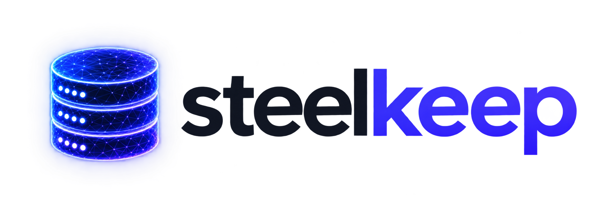

<picture>
  <source media="(prefers-color-scheme: dark)" srcset="public/brandassets/lockup-dark.png">
  
</picture>

Self-hosted database backups and reviewed recovery. TypeScript, TanStack Start and Elysia, with a web dashboard, REST/OpenAPI and native MCP for AI agents.

**Alpha software.** Eight engine adapters are implemented. Each has a deliberately bounded version and schema profile; the [acceptance ledger](docs/acceptance.md) distinguishes actual native recovery from metadata, UI and packaging checks. Full Databasement parity and the complete failure matrix are still in progress.

## What it does

- Database and S3-compatible storage connections, sealed credentials and revision-safe edits.
- Manual backups and timezone-aware schedules, persistent queueing, logs and filterable history.
- Immutable archives, SHA-256 verification, scoped streaming downloads and snapshot notes.
- Reviewed recovery into a separate, precreated empty destination; target identity and permissions are checked before writes.
- Keep-all by default; optional retention tiers, snapshot locks and explicitly reviewed single/bulk deletion.
- Owner email/password access and named AI agents with scoped, expiring, revocable credentials.
- The same application commands through the dashboard, REST, OpenAPI/Scalar and MCP.
- Light and dark appearance with the original Steelkeep artwork.

## Database profiles

| Engine | Current profile | Capture and prerequisites |
| --- | --- | --- |
| PostgreSQL | 17 | Exported snapshot; `pg_dump` / `pg_restore` 17. Sequence changes during capture refuse publication. |
| MySQL | 8.0, ordinary InnoDB tables | Real MySQL 8 clients and an explicitly permitted server-wide read lock. |
| MariaDB | 11, ordinary InnoDB tables | Separate MariaDB 11 clients and an explicitly permitted server-wide read lock. |
| MongoDB | 8.0 standalone | Database Tools 100.20; explicitly permitted, journaled server-wide fsync lock. |
| SQLite | Worker-local initialized files | Native Online Backup; separate allowlisted source and target mounts. |
| Redis | Standalone 7 / 8, one logical database | Atomic native DUMP/RESTORE with absolute expiry; up to 5,000 keys / 64 MiB. |
| ClickHouse | 25.8, Atomic / plain MergeTree | Server-native backup, an owner-maintained idle window and a backup disk shared with the worker. |
| SQL Server | 2019 / 2022 profile; 2022 tested | Read-only source, .NET 10 Linux x64 / DacFx 170.5.96; BACPAC logical portability. |

These are engine-specific profiles, not arbitrary-version or cluster support. Current archives are limited to 2 GiB. MySQL/MariaDB stored programs, views, triggers/events and non-InnoDB tables are refused. MongoDB replica sets/shards and ClickHouse distributed/replicated tables require additional profiles. BACPAC is not native `.bak`, log-chain recovery or PITR. Read [engine profiles](docs/engine-profiles.md) before connecting a real database. The current [server runtime ledger](docs/server-runtime.md) records exact native tools and independent recovery proofs.

## Self-host

Run setup as the intended non-root service owner. Prerequisites: Bun 1.4 for setup, Docker Compose, an S3-compatible bucket with credentials, and network access from the worker to the chosen database. Native package pins are in [Dockerfile.engines](Dockerfile.engines). SQL Server additionally needs the explicit [x64 extension](Dockerfile.mssql) and applicable Microsoft terms; it is not silently downloaded by the default stack.

```sh
bun install --frozen-lockfile
bun scripts/setup-local.ts
```

Edit `.env` before starting. Set exact database and S3 hostnames in `STEELKEEP_ALLOWED_HOSTS`. For HTTPS also set:

```dotenv
STEELKEEP_PUBLIC_HOSTS=backup.example.com
STEELKEEP_ALLOWED_ORIGINS=https://backup.example.com
STEELKEEP_SECURE_COOKIE=true
```

Keep the generated `.steelkeep/key`, `.steelkeep/token` and `.steelkeep/metadata-password` private. Setup preserves existing files. Build the web and multi-engine worker once, then start:

```sh
docker compose -f compose.selfhost.yaml pull database
docker compose -f compose.selfhost.yaml build migrate
docker compose -f compose.selfhost.yaml build worker
docker compose -f compose.selfhost.yaml up -d --no-build --pull never
```

The web server binds `127.0.0.1:4310` on the host. Put your HTTPS reverse proxy in front of that port; preserve the Host header and streaming responses. Metadata and archive storage are separate: the Compose file provisions PostgreSQL metadata, while you supply the S3 bucket. Worker-local SQLite files and ClickHouse shared disks need explicit mounts and allowlists described in [engine profiles](docs/engine-profiles.md).

Create a private, single-use setup link immediately before opening it:

```sh
docker compose -f compose.selfhost.yaml exec   -e STEELKEEP_SETUP_ORIGIN=https://backup.example.com   web bun scripts/setup-owner.ts
```

The link expires in five minutes and contains no installation key. Choose your name, email and password; later visits use ordinary sign-in. For loopback-only HTTP testing, use `http://127.0.0.1:4310` and `STEELKEEP_SECURE_COOKIE=false`. See [authentication](docs/authentication.md).

### Your first backup

1. In Connections, add your database and S3 storage; test both connections. Use a dedicated database role with the documented permissions.
2. Create a plan with that source and destination. Start manually or configure a timezone schedule.
3. Follow the actual worker phases in Jobs. Open the resulting snapshot to inspect size, SHA-256, availability and logs.
4. Test recovery into a separate empty destination. A stored archive and a successful restore validation are distinct results.

Keep an independent protected copy of the metadata encryption key. Losing it makes stored connection credentials unrecoverable. Artifacts are not claimed to be client-side encrypted; configure storage encryption and offsite retention separately.

## API and AI agents

- REST: `/api/v1`
- Scalar documentation: `/openapi`; JSON: `/openapi/json`
- Native MCP Streamable HTTP: `/mcp`
- Agent guidance: `/steelkeep-agent.md`

Create a named agent in Configuration → AI agents. The default grant is read-only with 24-hour expiry; tokens are shown once and stored hashed. Scopes are `read`, `configure`, `backup:run`, `restore:run`, `jobs:cancel`, `agents:manage`, `backup:delete` and `backup:download`. Delegation cannot increase permissions or outlive its issuer. Revocation includes descendants. No model-provider account is required. [Agent access](docs/authentication.md) and [architecture](docs/architecture.md).

## Recovery and deletion guarantees

An empty-target review expires and is bound to the actor, source artifact, destination identity and permissions. SHA-256 is checked before restore writes. Unknown restore outcomes retain a destination reservation and are never automatically replayed; inspect partial data and prepare a fresh target.

Snapshot availability HEAD checks inspect object metadata, not downloaded bytes. Native downloads and restores verify complete bytes. Manual deletion requires a reviewed selection and explicit acknowledgement; ambiguous conditional deletes stay held without retry. See [downloads](docs/snapshot-downloads.md), [reviewed deletion](docs/snapshot-deletion.md) and [retention](docs/retention.md).

## Development

The synthetic development fixtures contain deliberately public disposable credentials. Never reuse them for real services. Follow [architecture and development evidence](docs/architecture.md) and the guarded acceptance scripts; heavy native fixtures are opt-in.

```sh
bun run typecheck
bun run typecheck:acceptance
bun run test
```

Default tests do not start database fixtures. Native recovery acceptance must independently verify stored archive bytes and restored data. Historical proofs do not automatically qualify newer source, packages or rebuilt images. The [acceptance ledger](docs/acceptance.md), [native tooling](docs/native-tooling.md) and [parity tracker](docs/databasement-parity.md) record those boundaries.

## Contributing and license

See [CONTRIBUTING.md](CONTRIBUTING.md) and [SECURITY.md](SECURITY.md). Steelkeep source is [MIT licensed](LICENSE). Adapted Databasement interface material, fonts and optional Microsoft tooling retain their respective [notices and terms](THIRD-PARTY-NOTICES.md). Salt.md was an interaction reference; its AGPL source/assets were not copied.
